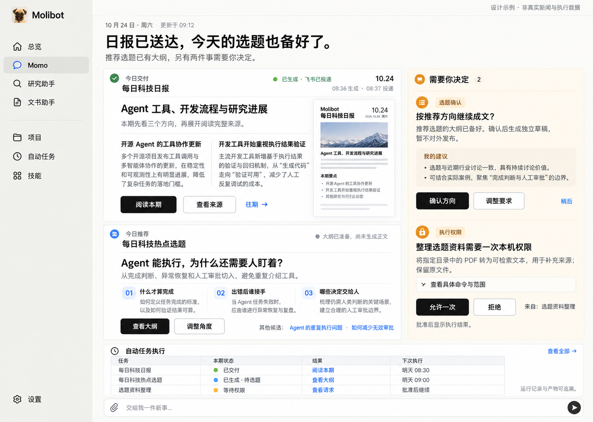

# Personal Agent 工作首页：委托进展、成果与必要决定

修订日期：2026-10-27。状态：既有投影的首页 UI 已于 2026-10-25 完成一轮优化；完整结果数据接线和本规格新增的展示要求尚未交付。本规格定义 Desktop 默认 Agent 工作首页，不代表持续跟进、主动监测或外部集成已交付。当前能力以[能力矩阵](../../requirements/personal-assistant-capability-matrix.md)为准。

实施入口：[GitHub Issue #68](https://github.com/gusibi/molibot/issues/68)，标签 `ready-for-agent`。Issue 保存完整文字规格；已确认的视觉参考随本文保存。

## Problem Statement

用户把一件事交给 Personal Agent，是希望减少记忆、准备、执行和催促的负担，同时保留重要决定的控制权。离开应用一段时间后，用户需要迅速知道：事情是否推进、成果能否使用、还有谁需要行动，以及原来的承诺是否有风险。

执行成功、发出消息和真正办成事情并不等价。只有聊天记录、工具日志或完成计数，用户仍需自己寻找成果、核实结果和拼接下一步。把每个正常步骤、可恢复错误和等待都交给用户处理，也会使助理成为新的管理负担。

日报和选题是具体交付场景，不能代替整个首页的组织原则。首页应根据已有委托的真实结果、进展和必要决定组织信息；没有证据的目标、期限、推荐或进展不得由界面补造。

## Solution

将默认 Agent 首页作为用户重新接手工作的入口，回答五个问题：

1. 已经办成什么，成果在哪里？
2. 哪些事情还在推进或等待，下一步由谁负责？
3. 哪些决定必须由我作出，材料是否已经准备好？
4. 哪些变化影响原目标、时间或授权？
5. 哪些事情会按已有授权继续，无需我反复催促？

主区以可使用的成果为主体，必要决定清楚可达；相关进展与下一步保持和原任务关联。日报适合阅读，选题适合比较，文档适合预览；它们共享任务来源和真实业务动作，不强制采用同一种通知行。没有成果但有待决定时，决定成为主内容。

既有双栏视觉基准、1152px 容器、响应式规则和输入入口继续适用。参考图用于阅读层级与布局，不是全部能力的清单；不要求每一页同时出现日报、选题、审批和执行表。没有内容的区域收起，不制造示例成果或卡片占位。

首页保持 Agent Handover 的共享读模型定位：不创建永久主对话、不承载 Agent Context、不另建任务调度器。它呈现已有能力的事实与可执行动作；缺少持续监测、业务集成或下一步执行能力时，明确说明边界，不把展示文案当作能力实现。

## User Stories

1. 作为 Desktop 用户，我希望进入默认 Agent 首页就看到最新自动交付，以便不用先进入自动任务管理页。
2. 作为 Desktop 用户，我希望顶部用一两句话说明成果和必要决定，以便快速理解今天值得关注什么。
3. 作为 Desktop 用户，我希望日报、选题和审批采用适合内容的展示方式，以便不必逐条打开通知猜用途。
4. 作为 Desktop 用户，我希望直接阅读日报的重要内容，以便首页本身就能提供帮助。
5. 作为 Desktop 用户，我希望日报显示真实期次和生成时间，以便辨认今天的新内容与上一期内容。
6. 作为 Desktop 用户，我希望每条新闻解读都能找到来源，以便核查依据。
7. 作为 Desktop 用户，我希望打开本期全文或产物预览，以便不必先翻聊天记录。
8. 作为 Desktop 用户，我希望从日报进入往期交付，以便比较连续几期的变化。
9. 作为 Desktop 用户，我希望没有配图时仍能得到清楚的文字排版，以便图片缺失不影响阅读。
10. 作为 Desktop 用户，我希望看到一个重点推荐选题及其角度，以便先理解 Agent 的判断。
11. 作为 Desktop 用户，我希望推荐选题带依据和已有材料，以便决定是否值得继续。
12. 作为 Desktop 用户，我希望比较其他候选选题，以便选择更合适的方向。
13. 作为 Desktop 用户，我希望查看选题大纲，以便在成文前判断结构是否合理。
14. 作为 Desktop 用户，我希望调整要求时保留选题与本期关联，以便不重新交代背景。
15. 作为 Desktop 用户，我希望确认选题方向与对外发布分别处理，以便不会因选择选题而意外发布。
16. 作为 Desktop 用户，我希望已授权的周期生成和投递继续自动执行，以便不用每天重复批准。
17. 作为 Desktop 用户，我希望待决定项显示目标、推荐与影响范围，以便能够依据具体材料作出决定。
18. 作为 Desktop 用户，我希望权限请求允许展开具体命令和对象，以便核对实际操作。
19. 作为 Desktop 用户，我希望能对支持的请求就地允许一次或拒绝，以便减少页面跳转。
20. 作为 Desktop 用户，我希望内容审阅能指出需要确认的部分，以便不把每份成果都变成强制审批。
21. 作为 Desktop 用户，我希望计划批准先展示执行范围和交付物，以便理解批准后的行为。
22. 作为 Desktop 用户，我希望发布确认展示完整内容和目标，以便核对实际将发送的版本。
23. 作为 Desktop 用户，我希望恢复请求说明已完成与不确定的步骤，以便避免重复执行副作用。
24. 作为 Desktop 用户，我希望结果验收展示完成标准和剩余问题，以便判断是否真正办成。
25. 作为 Desktop 用户，我希望某个请求无法在首页处理时能直达原处理入口，以便不会遇到无效按钮。
26. 作为 Desktop 用户，我希望多处处理同一审批时状态一致，以便不重复批准或看到残留请求。
27. 作为 Desktop 用户，我希望批准后看到真实后续状态，以便区分已批准、执行中和已完成。
28. 作为 Desktop 用户，我希望处理失败时原请求仍可理解且错误可见，以便知道是否需要重试。
29. 作为 Desktop 用户，我希望暂时收起待决定项不等于解决，以便之后仍能找到它。
30. 作为 Desktop 用户，我希望简洁核查各个定时任务本期执行情况，以便确认承诺是否兑现。
31. 作为 Desktop 用户，我希望内容生成、内容检查、投递和我的选择分开表达，以便不被一句成功误导。
32. 作为 Desktop 用户，我希望生成成功但投递失败时仍能阅读成果，以便不用重新生成整份内容。
33. 作为 Desktop 用户，我希望自动重试只更新同一期，以便不重复出现多个成果或请求。
34. 作为 Desktop 用户，我希望部分交付能显示可用内容和缺口，以便继续使用已有成果。
35. 作为 Desktop 用户，我希望主动停止、暂停、跳过与失败有清楚区别，以便正确理解运行情况。
36. 作为 Desktop 用户，我希望没有执行证据时显示未确认，以便不会误以为任务按时完成。
37. 作为 Desktop 用户，我希望查看任务历史和下一次真实排期，以便不依赖首页摘要排障。
38. 作为 Desktop 用户，我希望新一天产生新一期而上一期待决定项继续保留，以便不会漏掉未解决事项。
39. 作为 Desktop 用户，我希望来源 Agent 和 Channel 清楚可查，以便理解成果和权限的归属。
40. 作为 Desktop 用户，我希望普通聊天回复不被自动计为定时交付，以便首页不充斥无关记录。
41. 作为 Desktop 用户，我希望离开或重开首页后仍能看到最新一期成果，以便页面切换不会消费我的工作。
42. 作为 Desktop 用户，我希望没有新交付时仍能找到最近成果和已排期事项，以便首页保持实际用途。
43. 作为 Desktop 用户，我希望首次使用时有明确的新任务入口，以便不看到虚构的日报或空白卡墙。
44. 作为 Desktop 用户，我希望服务断开时保留已显示内容并标明时效，以便区分旧内容与正常状态。
45. 作为 Desktop 用户，我希望材料被删除或权限撤销时得到明确反馈，以便不会跳到错误会话。
46. 作为 Desktop 用户，我希望中英即时切换、明暗主题和窄窗口都保留完整操作，以便按自己的环境使用。
47. 作为键盘用户，我希望能按阅读顺序访问全文、来源和审批操作，以便无需鼠标也能处理首页事项。
48. 作为 Desktop 用户，我希望在首页输入新任务不会隐式续聊某份交付，以便新工作与事项内操作的上下文明确。
49. 作为产品维护者，我希望分组、计数、来源和可用动作由共享层统一定义，以便不同入口不会形成第二套业务状态。
50. 作为产品维护者，我希望每个正式按钮都有真实动作、结果与失败反馈，以便页面具备完整功能而非只适合截图。

51. 作为 Desktop 用户，我希望回到首页就知道原委托的目标和已确认的完成要求，以便不用重新交代背景。
52. 作为 Desktop 用户，我希望看到当前可核实的进展、下一步和负责方，以便区分正在执行、等外部回复与需要我决定。
53. 作为 Desktop 用户，我希望下一步未知时得到明确说明，以便不把推测当作已安排的行动。
54. 作为 Desktop 用户，我希望正常进展和中间工具调用留在详情，以便阅读首页时不必管理执行过程。
55. 作为 Desktop 用户，我希望每次必要决定都先提供问题、可用选项、影响和有依据的建议，以便减少重新调查的工作。
56. 作为 Desktop 用户，我希望决定确有期限时看到不处理的后果和最晚时间，以便安排注意力。
57. 作为 Desktop 用户，我希望承诺存在明确风险时看到受影响的目标和已有替代办法，以便及时调整。
58. 作为 Desktop 用户，我希望自动恢复且不影响承诺的小故障不升级为待处理事项，以便不被无效告警打断。
59. 作为 Desktop 用户，我希望已授权事项继续推进而不反复要求批准，以便真正减少催促。
60. 作为 Desktop 用户，我希望建议与已接受的委托清楚区分，以便一条推荐不会擅自变成任务。
61. 作为 Desktop 用户，我希望暂停、拒绝和完成后的事项按原业务状态展示，以便刷新后不会重新催促或复活。
62. 作为 Desktop 用户，我希望通过原业务入口调整要求或收回可撤销的授权，以便始终保留控制权。
63. 作为 Desktop 用户，我希望看到检查通过、成功发送与实际完成的证据边界，以便不会误以为所有目标都已实现。
64. 作为 Desktop 用户，我希望连续几天不打开应用后仍能找到最新成果和未解决事项，以便无需每日盯着助理。
65. 作为 Desktop 用户，我希望首页摘要先说明结果和对我的影响，再提供行动和依据，以便快速理解重点。
66. 作为 Desktop 用户，我希望普通完成结果留在首页而不会仅因刷新触发通知，以便自行选择查看时间。
67. 作为 Desktop 用户，我希望来源系统没有提供委托信息时仍能读取已有成果，以便缺失元信息不会让整个页面失效。
68. 作为 Desktop 用户，我希望同一委托的成果和决定相互定位，以便知道这份结果为什么还需要我的介入。

## Implementation Decisions

### 0. 委托、介入与表达原则

- **围绕原委托。** “委托”是用户希望办成的事的展示称谓，不是新业务实体。读取已有 Runtime Task、Plan、Durable Execution 或 Decision Request 的稳定身份；不同对象只有在源系统存在明确关联时才聚合。不以标题相似或模型推断跨 Session 合并。
- **保留目标与责任。** 对可获取的信息展示目标、完成要求、已完成部分、下一步及负责方、已确认期限和授权范围。缺失时省略或明确未提供；“等待外部回复”必须有对应业务证据，“下次检查”必须有真实排期。不能因为已有任务就声称存在持续跟进服务。
- **准备先于决定。** 必要决定按“问题与建议 → 对目标的影响 → 可选操作 → 可展开依据”表达。有真实期限时说明最晚决定时间与不处理后果；没有期限或推荐依据时不造紧迫性和建议。拒绝、修订、恢复都走原业务动作。
- **按用户价值组织。** 可直接使用的成果进入主区，必须由用户推动的决定保持可达，已核实且影响承诺的风险突出；正常步骤、工具调用和不会影响承诺的可恢复错误留在详情。执行记录数量不等于用户完成了多少件事。
- **授权有明确来源。** 只呈现用户已交代的工作、已授权的周期执行与已有业务请求。建议不是新任务，理解目标不是获得发送、消费或账号操作权限。原业务层执行授权校验，首页不能放宽，也不为已有授权机械增加审批。
- **可见与打断分离。** 打开、刷新、展开与阅读首页只查询事实，不发送新通知。普通交付在首页可见；用户决定、承诺风险和重要变化可在首页突出。任何跨渠道主动提醒的发送、聚合、节流和升级由既有通知或未来独立能力负责，本规格不新增通知策略引擎。
- **必要时才要求介入。** 不把自动重试、等待下一次排期或后台步骤转成待决定；不把无须操作的风险说明伪装成审批。被拒绝、暂停或解决的请求不得因摘要或旧快照复活。风险是否影响承诺须由源业务事实支持，前端不推断。
- **支持重新接手。** 用户数日未打开后，最近一期成果、开放决定、真实等待原因和可核实的下一步仍可找到。展示事实不承诺期间一定持续执行，状态未知时明确标注。调整、暂停、取消、撤销与继续仅提供原业务支持且仍有权限的动作；不可撤销动作说明真实边界。

### 1. 范围与架构

- 实施对象是 Desktop 默认 Agent 的工作首页。保留既有侧栏、Agent 身份、顶部工具栏、完整历史和文件入口，不新增通知中心一级入口，不改其他 Agent、Project 或 Agent Room 的页面布局。
- 首页汇总当前 owner 有权读取的普通 Agent Runtime Task 交付，来源属于其他普通 Agent 时明确标注。任意聊天回复不成为自动交付。Project、Room 的正文与产物不因进入默认首页获得额外读取权限；已有跨来源审批继续遵守原查询与动作权限。
- 单一共享读模型定义展示集合、分组、来源、期次、排序、去重与可用动作。前端只负责排版、局部展开、焦点与操作中的临时状态，不自行扫描会话、猜任务类型或拼第二套待审批集合。
- 复用 Runtime Task、Runtime Event、Durable Execution、Decision Request 和现有通知回执。首页不拥有另一份审批状态或任务生命周期，不把 Notification 当作新的任务 CRUD 对象。
- 本规格包含支撑 UI 所必需的结果投影与最小展示元信息接线；不包含主动发现引擎、长期跟进服务、新内容生成产品或第三方发布集成。

### 2. 模块与组件职责

| 模块或组件 | 责任 |
|---|---|
| Desktop Handover 共享读模型 | 组装整页、关联期次与结果、聚合待决定、计算排期和各数据源时效 |
| DesktopTask 与执行历史投影 | 提供任务身份、本期运行、重试、停止原因与历史入口 |
| 任务结果展示适配 | 将明确的交付数据映射为日报、选题、文档或通用交付；校验引用与字段边界 |
| AgentHome | 组合顶部摘要、主内容、待决定、运行概览和现有 Composer，不承担业务归类 |
| BriefingDeliveryCard | 日报式阅读、来源与本期全文入口 |
| TopicProposalCard | 推荐角度、候选比较、大纲与关联决策入口 |
| HomeDecisionCard | 渲染原业务动作、范围与处理反馈；复用现有审批分派 |
| HomeAutomationSummary | 紧凑执行概览和既有任务详情入口 |
| 共享 Artifact Inspector 与内容预览 | 打开已授权产物、正文和证据，不建设首页专属文件查看器 |

这些是职责划分，不要求每项都新建文件或服务；优先扩展现有模块，只有实际需要复用的展示单元才拆组件。

### 3. 布局与尺寸

默认视觉验收视口为 1440 × 1024。工作首页可以横向展开；已有聊天和设置阅读列不随本次改动加宽。

| 区域 | 布局与视觉要求 |
|---|---|
| 外壳 | 复用现有侧栏宽度和 52px 顶栏；应用图标读取用户当前选择，不固定写死参考图中的形象 |
| 首页容器 | 最大宽度 1152px，居中；正常宽度左右内边距 24–32px，窄宽 16px |
| 顶部摘要 | 日期与最后核实时间在上，28–32px 主标题，一行或两行说明；不展示大头像或 KPI 卡 |
| 主内容 | 内容可用宽度至少 960px 时采用约 2:1 两栏，间距 24px；左栏放日报与选题，右栏放待决定 |
| 日报与选题 | 各为独立内容对象，纵向间距 16px；正文、比较和大纲有实质内容，避免同构通知行 |
| 自动任务执行 | 主内容下方全宽，使用一个紧凑表格与细分隔线；不重复卡片正文 |
| 输入区 | 表格之后复用现有新对话 Composer，桌面约 52–64px 起高，允许随草稿增长 |
| 最近对话 | 使用单列紧凑行账本（最多四条）与完整历史入口，位于主要成果之后；不占日报和审批的首屏空间 |

主栏的正文以 14–16px 为基线，次级信息至少 12px，不通过极小字体把整页塞入一屏。1440 × 1024 的基准场景应能看到日报、重点选题、两项简洁审批、三条执行概览和新任务入口；更多内容自然滚动，不裁切、不强行等高。

语义表面、圆角、间距、颜色与控件复用项目主题 token。参考图的暖白、浅灰、黑按钮为默认主题表现；主题决定实际色值、材质和半径。普通列表无投影，重点内容可使用既有焦点表面；不添加渐变、大面积警告色或装饰性图表。

### 4. 顶部摘要

- 按“结果 → 对用户的影响 → 必要动作 → 依据”组织一两句结论；没有必要动作时不附加催促。只显示已准备、已执行或已核实的事实，不用拟人化措辞暗示未存在的持续照看。

- 摘要由当前投影的成果与待决定状态组成。例句“日报已送达，今天的选题也备好了”只有在生成记录、选题材料与投递回执均支持时才能出现。
- 区分“更新于”与“最近核实于”：前者表示内容版本时间，后者表示读取成功时间。时区使用用户配置，显示真实日期；不把上一期内容改名为今日内容。
- 无新增成果时说明最近一次可核实状态；有待决定时突出必要决定。不能因没有运行记录就宣称没有需要用户做的事。
- 仅在源数据确有不可用的阻塞时提升异常说明。后台自动重试不自动变成让用户修复的头条。

### 5. 日报卡片

日报是一个阅读对象。卡片结构依次为任务名称与期次、内容标题、简短导读、最多三个重点及各自的一句解读、全文与来源操作、生成及投递信息。

- 重点标题和解读来自本期结果。来源绑定到具体重点或本期来源集合；缺来源就明确显示未提供，不能生成占位链接。
- “阅读本期”直接打开本期正文或精确产物；“查看来源”展开对应证据；“往期”进入该 Runtime Task 的既有交付或执行历史，保持任务筛选与期次定位。
- 真实正文图片或产物缩略图可作为辅助手段，缺图时使用文字排版。主标题和可读内容始终存在，缩略图加载失败不影响全文入口。
- 投递状态独立于生成状态。已生成但投递失败时保留全文，显示投递失败及原系统支持的处理入口。
- 一个类型有多份交付时，主区优先展示最新一期，其他交付紧凑呈现；不把每天的旧期次无限追加成卡片墙。

### 6. 选题卡片

选题是一个供比较和推进的提案。卡片结构依次为任务名称、本期重点推荐、切入角度与推荐依据、最多三个可读大纲节点、已准备材料、其他候选与可用操作。

- 推荐顺序来自本期显式结果，不由浏览器按关键词或虚构热度重新排序。没有排名依据时只展示候选，不宣称最佳、热门增长或适合用户。
- 默认一个推荐项、最多两个紧凑候选；展开后看完整候选与依据。候选多不增加无意义的分数和图表。
- “查看大纲”是只读操作；“调整角度”带当前期次与选题引用进入原有可执行上下文。来源是外部只读 Session 时遵守只读边界，只提供可达的原处理入口，不隐式跨渠道续聊。
- “确认方向”只在有真实 Decision Request 或已有等价业务动作时出现。它绑定确切请求、执行和版本；不能从一段模型建议临时制造审批按钮。
- 选定方向、生成正文、验收内容和对外发布分别呈现。参考图中的确认只允许继续生成独立草稿，不包含发布授权。
- 若没有关联 Decision Request，选题可作为信息与材料展示；界面不伪装为正在等待用户的阻塞任务。

### 7. 待决定区

| 类型 | 内容与操作 |
|---|---|
| 内容审阅 | 显示待审版本、需确认部分及已有检查证据；只有原业务流程存在审阅动作时提供确认或修改 |
| 选题决定 | 显示问题、选项和推荐依据，调用原 Decision Request 回答动作 |
| 计划批准 | 显示目标、步骤范围、交付物与权限模式；复用 Plan 批准、修订和版本校验 |
| 工具／本机权限 | 显示为何需要、操作对象与影响，具体命令可展开；复用允许一次、拒绝或原入口 |
| 对外发送／发布 | 仅当集成和动作已存在时出现；展示精确版本、目标、附件和时间，不借本 UI 新增集成 |
| 中断恢复 | 展示已完成部分、不确定结果和将继续的位置；调用原恢复流程，不能转换成盲目重跑 |
| 结果验收 | 展示完成标准、产物和剩余问题，复用确认完成或继续工作的动作 |

- 桌面默认展开最多两项；其余以“查看全部 N 项”在当前首页展开同一区域，不丢失原事项定位。阻塞交付的真实请求优先，其次按已有明确期限、创建时间排序；缺少期限时不制造紧急标签。
- 每项至少包含来源任务或执行、请求问题、操作范围、可用依据与实际动作。Agent 推荐是可选信息，缺少依据时省略推荐段落，不影响用户查看原请求。
- 所有动作携带原请求标识和所需执行版本。审批通过、任务执行、产物交付分别更新，不能把允许一次立即显示为任务已完成。
- 在一个入口处理后其他入口读取同一业务状态。重复点击、另一窗口先处理、版本冲突和服务重连均不能重复执行或留下可点击的过期批准。
- 操作中仅锁定有关事项的冲突动作，其他阅读入口与无关请求可用。失败反馈位于原事项内，保留内容；恢复后重新对齐权威状态。
- “稍后”只表示暂时收起这项决定，不解决请求、不暂停任务、不创建提醒。收起后保留摘要与恢复入口，标题中的待决定数不减少；离开首页或重开应用后仍按源状态展示。需按时间延后提醒的能力不在本规格范围内。
- 原来源已删除或权限失效时取消本页动作并说明原因，不跳到任意会话。仅失去产物引用不能被改写为整个任务执行失败。

### 8. 自动任务执行概览

表格默认展示最多五个与首页有关的用户任务，优先等待决定、未兑现或不确定的本期执行，再展示本期已交付与下一次排期。内部记忆维护等系统任务不占首页主区，继续由原管理入口查询。

列为“任务、本期状态、结果、下一步／下次执行”。有真实排期时显示时间；等待外部、等待用户或下一步未知时分别说明事实，不把所有等待都标成等待用户。同一任务的正文只存在主内容或详情，表格只给概要和操作链接。点击任务或“查看全部”进入现有自动任务工作区，并用稳定任务身份选中目标；查看某次执行必须同时带期次或运行身份。

| 事实 | 展示要求 |
|---|---|
| 已生成且有投递回执 | 可显示已交付，全文继续可读 |
| 已生成、有开放选题决定 | 显示已生成／待选题，不能显示生成失败 |
| 自动重试 | 显示重试中与已确认的下次重试时间；同一期不复制卡片 |
| 等待审批 | 显示等待权限或等待决定，并定位原请求 |
| 部分交付 | 显示可用内容和具体缺口；需要真实部分结果证据 |
| 内容可用、投递失败 | 分别显示内容已生成与投递失败，不要求重新生成内容 |
| 用户停止、跳过、暂停 | 使用各自事实与原因，不统一变成红色失败 |
| 到期但未找到记录 | 显示未确认执行；只有调度器给出明确结果后才能判定漏跑或过期 |
| 下次排期未知 | 显示未提供，不以固定加一天推算 |

排期使用调度器相同的 cron、时区和一次性时间规则；审批后继续属于业务等待，不伪造一个时间。执行详情复用已有开始／结束、尝试次数、错误、产物和回执视图。最近七次执行状态带仅在有完整数据时使用，缺失显示未知；它是执行历史的紧凑入口，不增加完成率 KPI。

### 9. 数据契约与最小接线

沿用整页交接读接口，统一扩展 Desktop 共享契约和客户端调用；不为日报、选题、审批卡和表格分别增加首页接口。原审批、Plan、Decision Request、任务管理和 Artifact 接口继续负责动作与详情。

整页投影按各数据组的可用条件表达以下内容；具体类型名可遵循现有命名，不引入另一套状态别名：

| 数据组 | 必须具备的信息 |
|---|---|
| 页面与来源 | 当前 owner 范围、默认 Agent 身份、生成时间、各来源最近成功读取时间与读取错误 |
| 交付身份 | 稳定 Runtime Task 身份、计划触发槽位、本期身份、实际运行及结果版本、来源 Agent／Channel／UI Session |
| 委托背景 | 已存在的目标、完成要求、授权范围、期限、下一步、负责方及其业务来源；按源数据可用性提供，不要求新建委托存储 |
| 阅读展示 | 显式内容类型、标题、导读、重点或候选、大纲、来源引用、正文及产物引用；字段须有界 |
| 执行 | 真实运行状态、起止时间、重试与停止原因，不能由展示正文推断 |
| 内容 | 实际生成结果、部分内容、检查证据或未知状态；模型自称检查通过不等于机器或人工验收 |
| 投递 | 目标、与本期对应的发送状态和回执；通知被接收不代表用户已阅读 |
| 决策 | 原请求身份、选项、允许的动作、所需版本、范围与真实业务状态 |
| 排期 | 调度器核算的下一次时间、时区或明确未知／审批后继续 |

结果展示元信息随原任务交付结果归属保存，不保存到全局 settings，不复制任务和审批状态到一个新通知表。实际写入由现有共享任务交付收尾路径负责；模型不直接写数据库。新增字段必须贯通生产写入、读取和共享契约，不能只由测试 seed 提供。

日报与选题的类型由交付方显式提供并校验。现有普通文本结果作为一等“通用交付”展示，内容仍精确来自本次运行；不维护新旧接口兼容层、不靠任务名称硬编码类型，也不在每次打开首页时另调模型分析历史。若当前生成流程尚不能写出专用展示数据，实施单元必须先完成该最小接线，不能用固定示例宣称专用卡片已交付。

最小展示描述使用一个带类型的结果字段，随任务执行返回结果进入共享交付收尾。类型为 `briefing`、`topic-proposals`、`document` 或 `generic`；运行时填入任务、期次、运行身份和实际时间，不信任生成内容自行声明的执行成功、权限或投递回执。各类型的内容如下：

| 展示类型 | 内容字段与引用 |
|---|---|
| `briefing` | 标题、导读、重点集合；每个重点有标题、解读和来源引用；正文或产物引用 |
| `topic-proposals` | 候选集合；每项有稳定候选身份、标题、角度、推荐依据、大纲和来源；推荐项引用与原 Decision Request 引用可选 |
| `document` | 标题、用途摘要、产物引用；文件类型和可预览能力由现有 Artifact 解析 |
| `generic` | 本次运行的真实标题、正文摘要及已存在的正文／产物引用，不伪造新闻重点或候选 |

共享层校验展示描述的类型、长度、引用归属与集合上限；无效结构标明详细结构不可用，仍允许按精确引用打开真实原文。某个展示描述失效不应导致其他交付或审批全部消失。读模型只读取所需任务的最近期次、开放请求和有界结果，详情按需加载；不扫描全部 Session 正文。响应需表达分页或截断，不能把一个受限集合的数量和状态宣称为全量。

引用以运行、产物、证据和请求的稳定身份解析；禁止用会话最后一条消息替代历史运行结果。对一个结果的内容修订更新结果版本；已批准的具体发布版本不能随新版本悄然改变。

### 10. 期次、窗口和持续可见性

- 一个周期任务的本期身份来自稳定任务身份与计划触发槽位。重试归属同一期；手动独立执行保留自己的运行身份；第二天产生新一期。任务改名不会改变已有期次与结果身份。
- 每个任务保留最近一期成果供首页读取，历史由既有执行记录和产物存储提供。内容不是按未读通知逐条累积；用户没读不生成另一项待办。
- 最新交付与开放请求不以离开首页的时间窗筛除。首页不再用旧上一代交接正文替换当前结果，更不能因此隐藏新的审批。
- 实施时删除仅供旧首页事件窗口与上一代展示使用的状态、调用和分支；若其他现有功能仍使用历史确认，保留其独立职责，不能让它消费工作首页成果。删除持久化字段也要验证导航和其他配置不被覆盖，不编写历史数据迁移或双协议兼容层。
- 今日尚无新一期时可展示最近一期，明确写真实日期与下一次排期。开放请求不受一期切换影响；已解决的请求不从旧快照复活。
- 本规格不增加全局已读、收藏或任意时间稍后状态存储。以后若增加，它们应与业务状态和投递记录分离，按其真实所有权设计。

### 11. 详情、上下文和新任务输入

- 阅读正文、文件和来源优先使用既有内容预览及 Artifact Inspector；任务记录进入原自动任务详情，保持当前任务和执行的定位。
- 调整角度、继续成文、批准或恢复都绑定原业务对象。没有可执行的来源上下文时提供明确说明或原渠道入口，不发一个丢失关联的新消息。
- 底部新任务输入区复用当前首次发送才创建 UI Session 的行为，显示“交给我一件新事…”；不会自动将页面上某张卡的正文混入 Agent Context。
- 关闭详情回到原滚动位置；刷新不重置用户已展开的来源和正在阅读的内容。删除或权限变化使引用不可用时，在原位置说明，不复用其他项目或会话内容。

### 12. 状态、加载与刷新

| 页面状态 | 行为 |
|---|---|
| 首次读取 | 同布局骨架；数据未到时不先显示一套虚假的安静首页 |
| 首次使用、无任务 | 紧凑身份、新任务输入和已有起点；无日报示例、空表格或强制配置向导 |
| 有排期但尚无结果 | 显示真实任务和下一次排期，说明尚无本期成果 |
| 没有新交付 | 保留最近成果的真实日期和现有排期；无内容的区块收起 |
| 只有待决定 | 待决定成为主内容，不留下一个巨大的空左栏 |
| 单一数据源读取失败 | 标明受影响区域并保留可读的其他区域；不能把审批读取失败当作零项 |
| 服务断连 | 保留上次成功内容，显示未更新与最近核实时间；禁用变更动作，允许可用的缓存阅读 |
| 服务恢复 | 重新对齐结果、请求版本和投递状态，不重复生成、发布或启动任务 |
| 来源或产物不可用 | 原位说明不可用，其他内容保持可操作 |

沿用首页可见时的既有刷新节奏与恢复可见立即刷新；刷新只查询事实，不触发生成或模型润色。过期请求和旧连接响应不能覆盖新连接、新 Agent 或新结果版本。正在编辑的草稿、焦点和滚动位置保持稳定。

### 13. 响应式、主题与可访问性

- 布局依据主工作区可用宽度，不能只看整个窗口：不足 960px 时改为单列，待决定移到摘要之后，再显示日报、选题、执行概览和输入区。宽度不足不能压缩操作至不可读。
- 390px 窄窗口隐藏或折叠既有侧栏。新闻重点和大纲改为纵向；执行表改为带明确字段标签的紧凑行，每行保留结果与详情操作，不制造全页横向滚动。
- Drawer 按现有宽度能力打开；窄窗使用既有全宽详情形态。主区不能因为 Inspector 打开而溢出。
- 所有新增文本进入中英翻译词条，切换后立即更新。日期、时刻、相对时间和任务时区不得只做中文字符串替换。
- 使用共享 shadcn-svelte／Bits UI 控件、既有语义 CSS 和图标体系；不在页面堆裸工具类、独立 style 或自造开关。响应式依赖使用显式派生状态，不能藏在模板直接调用的无参 helper 中。
- 主题支持明暗及代表性零圆角主题；状态同时用文字、图标或形状表达。关闭动态效果时仍能辨认运行和操作状态。
- 标题、区域、按钮和表格有正确语义与可访问名称。Tab 顺序遵循视觉阅读顺序；来源展开、详情打开和关闭有焦点管理，错误可被读屏感知；不将整个频繁刷新区设为不断播报的 live region。
- 操作采用现有控件尺寸与焦点样式。窄窗触摸目标通过布局提供足够点击区域，不把标题、范围和危险动作塞进一行截断。

### 14. 内容与信任边界

- 执行成功不自动变成内容验收通过，批准不自动变成交付完成，已投递不自动变成已阅读。
- 标题、来源、推荐理由、检查结论和时间均必须有本期数据支撑。未核实内容标为未核实；不使用虚构的热度增幅、完成比例或质量分。
- Markdown、文件预览与来源链接沿用既有安全渲染和授权解析。正文及附件不能成为绕过权限的执行入口，首页不发送原始凭证和本机绝对位置。
- 已授权的定时生成和投递按原约定执行；首页只承接真实新增决定。刷新、阅读、展开和关闭页面均不制造审批。
- 有真实发现与准备材料时可用同一交付组件展示；本 UI 的上线不能用来宣布主动发现或持续跟进能力已交付。

### 15. 实施单元与完成边界

| 单元 | 必须跑通的完整行为 | 完成证据 |
|---|---|---|
| A：结果与主区 | 本地模拟模型经真实任务执行产出本期结果，生产路径保存展示数据，整页读取返回日报／选题或通用交付，首页能打开正确全文与来源 | API 与临时存储集成、期次和来源负向用例；不能只提交 fixture |
| B：决定与运行概览 | 真实 Decision Request 和 Host Bash／Durable 请求进入右栏，操作更新原业务状态；表格关联正确任务、结果与下一次时间 | 审批两处一致、重复操作、版本冲突、生成／投递分离和运行状态用例 |
| C：界面与恢复 | 完成参考图的信息层级、窄宽、中英、主题、详情返回、冷启动和服务恢复 | 首页定向 UI、类型检查、构建与隔离冷路径证据 |

每个单元保持已跑通的行为，不把数据接线、必要权限或失败反馈留作临时补丁。各单元均须遵守第 0 节的委托与介入原则；背景与下一步使用既有业务事实，相关源数据不存在时验收明确缺失的表达，不要求开发独立持续跟进服务。三项完成后才能声明本规格交付；不以一个卡片的截图替代整页行为验收。

## Testing Decisions

测试入口已于 2026-10-25 经用户确认：复用整页交接 API 与现有审批／任务动作，界面扩展现有 Agent 首页用例。只使用隔离实例、临时数据库与本地模拟模型，不为每个卡片建立新的业务测试入口。

好的测试同时断言界面反馈、原业务状态和真实结果，包括持久化与副作用次数。模型是可替换依赖，其余尽量走已有生产装配；不绑定私有 helper、CSS 层级、卡片文件数量或固定新闻文案。

### 主要入口与先例

沿用 2026-10-25 已经用户确认的测试入口；本次不引入新的业务测试接口。主入口仍为整页交接 API，配合原业务动作后再读；生产写入与重启通过临时 store 验证，实际排版与焦点通过既有首页 UI 用例验证。

- **主业务入口：** 整页交接读取接口，结合既有任务、Plan、Decision Request、Host Bash／Durable 审批和 Artifact 动作。已有交接 handler 集成用例可覆盖期次、聚合与动作后再读，不新增每卡接口。
- **持久化：** 复用执行租约、任务投影、Session 装配与现有临时 store 模式；验证生产收尾写入后重新打开 store 能读取同一期结果、展示字段和引用。改动导航设置时执行既有整对象 round-trip，其他字段必须保持。
- **界面：** 扩展现有 Agent 首页用例和隔离实例 fixture，使用角色、可访问名称和稳定业务身份定位；更新受影响的覆盖清单。审批失败、页面恢复和资料预览复用现有先例。
- **原生：** 本规格不预设修改 Tauri、Supervisor 或 HTTP 传输。若实现确实触及原生链路，增加对应原生断言；浏览器测试不得充当原生 App 验收。

### 必需场景

除下表既有场景外，增加以下外部行为断言：

- 同一原任务存在结果与开放决定：能够互相定位，决定前显示真实问题、范围和已有选项；缺推荐依据不展示推荐。
- 已确认目标、期限和下一步存在与缺失：分别正确呈现，不补造负责方、紧急性或下次检查时间；不同任务即使标题相同也不合并。
- 正常步骤、可自行恢复且不影响承诺的失败、真实等待和需要用户决定分别构造：前两者不产生待决定，外部等待不误报等用户，真实决定仍可处理。
- 首页读取、重复刷新、阅读与关闭：没有新增任务、模型调用、审批、通知或外部写入；请求被拒绝或解决后不因旧快照复活。
- 数日后重开：最近成果和开放请求仍可达，历史期次不冒充今日成果；没有继续执行证据时不声称持续推进。
- 原业务不支持修改、撤回或续聊：给出真实限制或原入口，没有空按钮或未经授权的替代执行。

| 场景 | 必须断言 |
|---|---|
| 日报＋选题＋两项审批＋三条执行 | 主区为可读内容，决定有背景与真实操作，执行表定位正确结果 |
| 生产交付写入与重启 | 专用展示字段并非只存在于 seed，重新打开 store 后期次、正文和引用一致 |
| 同一期重试、下一期到来 | 重试不复制；新期次独立；上一期开放决定仍存在 |
| 一段普通聊天与一个定时交付 | 聊天不充当自动交付，真实交付可见 |
| 同一 Session 先后运行 | 旧运行预览仍对应旧结果，不读取后一次消息冒充成果 |
| 生成成功、投递失败或回执未知 | 全文可读，状态分离，没有错误的已送达声明 |
| 部分结果、缺来源或缺缩略图 | 明确缺口，内容可读；无虚构链接和质量结论 |
| 选题无真实 Decision Request | 能看材料，不出现伪造的确认方向按钮 |
| 选题确认与正文／发布边界 | 回答原请求仅触发允许的后续步骤，没有新增发布副作用 |
| 允许／拒绝、重复点击与另一窗口先处理 | 同一源状态两侧一致，副作用次数符合原接口幂等要求 |
| 批准后执行仍未结束或失败 | 已批准、执行中与结果分开；失败在原事项可见 |
| 版本冲突、来源删除、权限撤销 | 不执行陈旧动作、不串来源，反馈明确 |
| 查看本期、来源、往期和执行详情 | 打开对应的真实内容及任务／期次，关闭后恢复位置 |
| 离开首页、后台隐藏、应用重开 | 最近一期交付保留，开放请求不被快照或确认窗口隐藏 |
| 首次、仅排期、仅审批、无新一期 | 版式成立，无假数据、空卡墙和伪装成今日的旧期次 |
| 任务运行、重试、跳过、停止、暂停、中断 | 显示各自事实；未知记录不被认定为成功或漏跑 |
| 单来源读取失败、整服务中断与恢复 | 保留有用内容，错误不会变成零审批，重连不重做业务 |
| 中英即时切换、明暗、零圆角、390px | 无全页横向溢出，主要内容和动作可达，字段名保持清楚 |
| 键盘与焦点 | 可阅读、展开、处理、关闭详情，焦点不跳失，错误被感知 |

回归用例在可行时先注入对应故障证明会失败，修复后通过；新增用例入集前连续运行五次通过，不能增加重试或放宽断言掩盖问题。UI 实施必须执行直接相关测试、Desktop 类型检查、构建以及隔离冷路径：重启服务、首次打开、切换 Session／页面、服务中断后恢复。

文档编写阶段只检查结构、引用、图片和改动范围，不运行未修改产品的测试或构建。实施阶段按改动执行定向用例；全量 `pnpm verify:feature`、全量浏览器 UI 和 `pnpm test:app` 留作用户主动执行的整体验收。缺少原生驱动构建或真实渠道专项授权时明确记为未验证；本规格不读取真实用户数据、不停止现用服务、不调用付费 Provider。

## Out of Scope

- 在本次文档任务中实施产品代码、替换用户安装包、部署或接真实账号。
- 永久主对话、跨渠道无缝续聊、跨 Session 全量历史注入。
- 完整通知中心、第二套任务数据库、无限活动流、全局已读／收藏／按时间稍后系统。
- 自动发现引擎、持续跟进服务、隐式偏好学习、模型自行生成新的待办。
- 新的新闻抓取、热点识别、日报生成或文章生成产品；本规格只约束其已有或随后明确接入的交付如何展示。
- 外部日历、邮箱、联系人、浏览器自动化和未接通的发送／发布集成。
- 新指标看板、热度分、收益估计、完成率或人为编造的运行百分比。
- Project、Agent Room 和其他 Agent 首页改版；把它们的私有正文自动汇入默认 Agent。
- 独立首页文件预览器、另一套审批引擎、OS scheduler、旧数据迁移和新旧协议兼容层。
- 参考图中的具体新闻、时间、候选标题、配图和任务名称作为生产默认值。

## Further Notes

### 文档职责与取代范围

- 本规格接管新工作首页的布局、交付展示、最近期次可见性及验收。它修订旧首页只按历史交接条目呈现、安静时回到通用开始页和排除本工作首页形态的范围约定。新实现交付前，旧文档仍描述已实施行为。
- [Agent Handover 交付规格](agent-handover-spec.md)保留其已交付证据、计数去重与审批同步等仍有用约束；本规格仅部分取代其 UI 与窗口约定，因此继续保留并互相引用，不整份归档。
- [Personal Agent V1](../../requirements/personal-agent-experience-v1.md)继续负责身份、导航与原行为规范。实施时在同一单元更新受影响的首页规则和验收引用，不以新文档重新安排旧的已交付任务。
- [ADR 0006](../../adr/0006-agent-handover-is-a-projection.md)中的“首页是投影、不是会话”继续成立。其历史窗口与成果来源限制由本规格的目标行为作局部修订；Dashboard 在此表示工作成果与决定的丰富展示，不授权运行监控平台或全量活动流。
- [ADR 0003](../../adr/0003-runtime-tasks-and-mini-app-todo-boundary.md)与[ADR 0004](../../adr/0004-per-domain-databases-and-state-representation.md)继续约束任务、通知与持久化所有权；不通过首页制造第二套业务状态。
- [持续跟进 PRD](../../requirements/proactive-assistant-v1-spec.md)和[对应实施设计](../agent-runtime/personal-agent-follow-up-spec.md)继续独立管理主动帮助的生成能力。本规格提供展示位置，不把那些规划能力计为已交付。
- [旧首页探索](../personal-agent-home/README.md)保留历史方案说明；其中的旧截图与一次性 HTML 不作为本次实施目标。未提交的其他首页草稿也不能替代本规格中的已确认参考图。

### 发布与交付记录

2026-10-25 的 UI 优化沿用原交接投影，完成成果／待决定响应式布局、命令展开、执行记录呈现及断连按钮状态；不代表单元 A、B 或完整单元 C 已验收。

2026-10-27 补充委托背景、下一步责任、必要介入和安静表达规则，原地更新 Issue #68，保留 `ready-for-agent` 标签。本次只更新规格，不改产品代码或能力矩阵状态；标签表示规格可用于实施，不表示行为已交付。

整体 Personal Agent 的理解、准备、执行、等待跟进、核实交付与纠错恢复是产品方向。本 Issue 负责这些能力在工作首页中的真实呈现和必要数据接线；持续跟进、主动监测与外部集成继续由独立需求管理，本次不自动批准其开发。

竞品截图仅用于理解内容组织和控制方式，不能证明竞品实际能力，也不构成本产品的能力或界面承诺。后续实施按事实更新需求状态、设计规则、覆盖清单、功能记录和必要的对外摘要。
