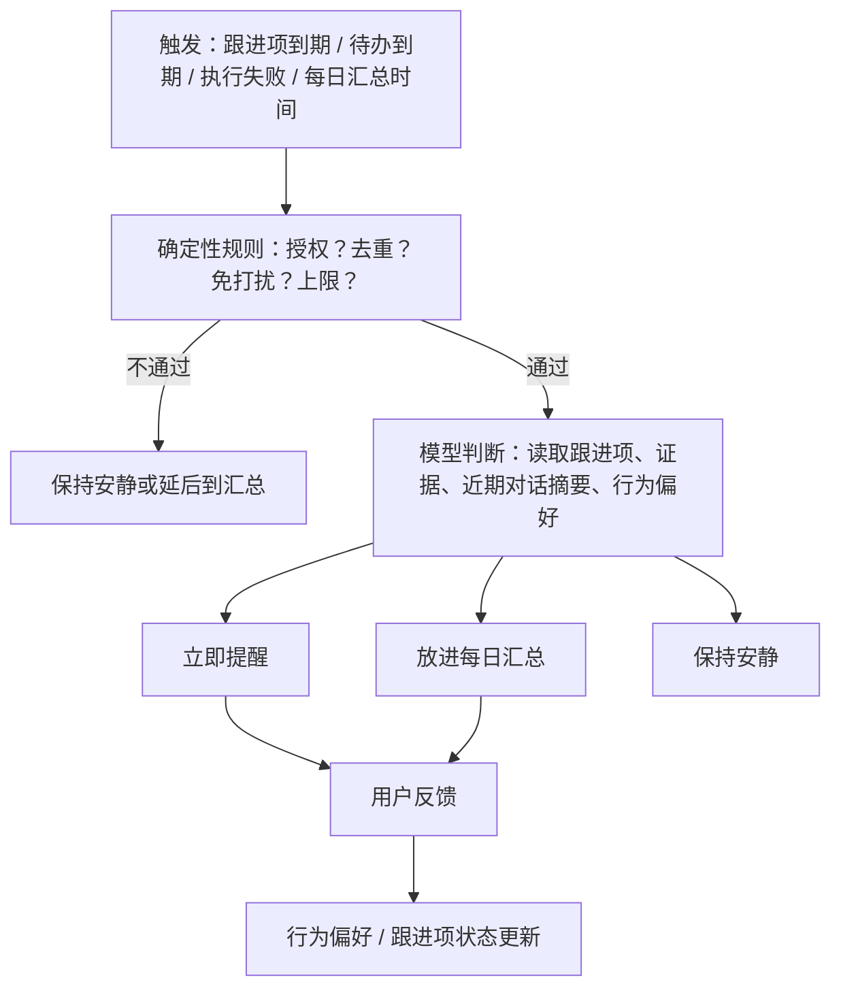

# Momo 主动助手 V1 规格

状态：草案，方向已确认（2026-10-14），待实施。当前能力状态以 [能力矩阵](personal-assistant-capability-matrix.md) 为准。

与 [Personal Agent 体验升级 V1](personal-agent-experience-v1.md) 互补：那份解决「Agent 是谁、Session 归谁」，本规格解决「Agent 不被问时也能有依据地帮忙」。不替代 Memory、Runtime Task 或 Durable Execution 各自的规范。

## 1. 要解决的问题

Molibot 只有一个触发源：用户发消息。用户不开口，Agent 不做任何事。记忆、反思、定时任务、渠道推送都已交付，但没有连成闭环：

- 记住了偏好，不等于下次自动照顾这个偏好。
- 能执行用户指定的提醒，不等于发现用户可能忘了的事。
- 能完成一次任务，不等于持续关注用户授权它跟进的事情。

V1 的目标：**减少用户需要自己管理、重复说明、重复检查的事情**，不是让 Agent 说更多话。

## 2. 核心原则

1. **授权才持久。** Agent 推测出的需求只能当场问一句；只有用户明确同意，才能变成持续跟进或提醒。「我猜你关心」≠「你授权我跟进」。
2. **有依据才开口。** 主动消息必须来自真实记录（跟进项、到期待办、执行结果），不能只凭聊天沉默推断。依据不足就保持安静。
3. **确定性规则先行。** 免打扰、每日上限、去重、到期判断、权限用代码规则处理；只有理解自然语言和综合上下文时才调用模型。
4. **三种结果。** 每次判断输出「立即提醒 / 放进每日汇总 / 保持安静」之一。
5. **知识反馈与行为反馈分离。** 「你记错了」修正记忆；「现在别提醒」只调整打扰行为，不删除目标或记忆。
6. **事实 / 推断 / 近期状态分开。** 用户明确说过的优先于系统推断；推断带置信度；近期状态必须有过期时间。
7. **共享层实现。** 判断与跟进逻辑放在共享上层，调度走现有 watched event 与 Task Scheduler；Channel 只负责收发和按钮渲染。

## 3. V1 范围：三个场景 + 每日汇总

### 场景 A：记住我的风格

现状：反思产出候选，用户在 Telegram/飞书按「保留 / 忽略」确认（技能草稿需在 App 审核）；明确纠正只靠关键词正则识别。

V1 要做：

- 偏好记录区分来源：`explicit`（用户直接说过）与 `inferred`（多次交互推断）。复用记忆已有的 `confidence`、`sources` 字段，不新建记忆引擎。
- 同一类表达被用户纠正 ≥2 次（跨会话），生成一条 `inferred` 风格偏好候选，附带纠正原话作为来源。
- 低风险风格偏好（措辞、长度、格式、先结论后细节等）由重复纠正推断出来时可自动生效，回复中不额外声明；可在记忆中查看来源并撤销。健康、情绪、财务、人际类信息永不自动生效。
- 冲突时 `explicit` 胜过 `inferred`；同一主题新的 `explicit` 取代旧的。
- 生效的风格偏好进入每轮实际使用的记忆快照，不只是可被检索。

### 场景 B：授权后的跟进

新增轻量「跟进项」（Follow-up），与记忆、待办、Durable Execution 区分：记忆记录发生过什么，跟进项记录用户授权 Agent 持续关注什么，待办/执行记录下一步具体做什么。

| 字段 | 说明 |
|---|---|
| id / ownerId / agentId | 稳定身份；归属 Agent 使用固定 Agent ID |
| title | 例如「MoliTodo 时间轴改造」「英语会议交流练习」 |
| intent | 用户想达到什么（一句话） |
| status | `active` / `paused` / `done` / `cancelled` |
| nextCheckAt | 下一次检查时间，由用户设定或双方确认 |
| cadence | 可选的复查周期 |
| evidence | 进展证据列表：关联的待办完成、执行结果、用户在对话里的更新 |
| sourceSessionId | 授权发生的会话 |
| createdBy | 只能是 `user_confirmed` |

流程：

1. 对话中用户提到承诺或目标时，Agent 可以提议「要我在 X 时候跟进吗？」。提议本身不落库。
2. 用户在对话中同意，或点击渠道按钮确认，才创建跟进项；没有成功创建就不承诺到点联系。
3. 到达 `nextCheckAt` 时，通过新的内部事件触发一次检查（见第 4 节），读取证据后输出三种结果之一。
4. 用户可随时在对话中暂停、完成、取消、改时间。
5. 每条跟进消息带「有用 / 稍后 / 不再提醒这类」按钮（见场景 C）。

不做：从闲聊自动创建跟进项；把跟进项当成 Durable 长任务；无限期跟进。连续 3 次「稍后」或检查时无新证据且用户未回应，跟进项转 `paused` 并在汇总里说明一次。

### 场景 C：学会什么时候打扰我

- 确定性规则（设置项，默认值见第 6 节）：免打扰时段、每日立即提醒上限、同一跟进项最短间隔、去重。
- 每条主动消息带三个按钮，结果写入独立的「行为偏好」存储，不写入知识记忆：
  - 有用：记录正向信号。
  - 稍后：按跟进项的复查周期顺延；记录该时段不合适。
  - 不再提醒这类：该类别（例如某个跟进项、或「工作日白天的学习提醒」）不再立即提醒，只进汇总；不删除跟进项本身。
- 下一次判断时，行为偏好作为输入。只能调整打扰决策，不能修改 Agent 提示词、权限或工具配置。

### 每日汇总

- 每天一次（时间可设），收集当天「放进汇总」的条目、即将到期的跟进项与待办。
- 没有内容就不发。
- 在汇总中仍可对每个条目给出反馈。

## 4. 判断流程

实现约束：

- 新增内部事件类型 `proactive-check`，复用 `InternalEventKind` 与 watched event JSON；不写 OS scheduler，不用 memory 代替调度。
- 模型判断是一次有边界的内部运行：只读工具、低预算、无副作用；输出为结构化决策（结果、理由、给用户的文本），解析失败按「保持安静」处理并记录运行事件。
- 判断用的临时控制指令不写入 Session，不回灌后续轮次；决策记录作为结构化运行事件持久化，便于排障。
- 立即提醒投递到用户设置的渠道，复用现有通知的去重、离线诚实和重启补偿语义。
- 第一版事件源只有：跟进项到期、Runtime Todo / 提醒到期、Durable 执行失败或等待决策。日历等外部事件源属于后续阶段。

## 5. Momo 规则调整

[momo/AGENTS.md](../../src/lib/server/agent/prompts/templates/momo/AGENTS.md) 当前写着主动关心只在对话中发生、不自行安排后续联系。改为：

- 可以在对话中提议跟进；只有用户明确同意后才创建跟进项或提醒。
- 不自行安排每日问候、健康或情绪追踪。
- 主动消息必须基于跟进项、到期事项或执行结果，并说明依据。

修改该内置模板时必须 bump `version`；已改动的落盘副本按既有规则先备份再覆盖。

## 6. 设置项

在 Desktop 与 Web 设置中新增「主动助手」区块（细粒度保存 API，固定底栏，中英文，明暗主题，移动宽度）：

| 设置 | 默认值 | 说明 |
|---|---|---|
| 启用主动助手 | 开 | 关闭后不触发任何 `proactive-check`，已有跟进项保留 |
| 投递渠道 | Momo 已绑定的首个外部渠道；无绑定时仅 Desktop | 用户可选 Telegram / 飞书 / Desktop |
| 免打扰时段 | 01:00–10:00（本地时区） | 期间的立即提醒延后到时段结束或进入汇总 |
| 每日立即提醒上限 | 3 | 超出部分进入汇总 |
| 每日汇总时间 | 21:00 | 无内容不发 |

默认值待用户确认，可在实施前调整。

## 7. 明确不做

- 新记忆引擎、记忆底层重构。
- 高频心跳扫描全部对话。
- 首页「今天值得关注」看板（后续阶段，只展示真实记录）。
- 日历、邮件、联系人集成（日历在后续阶段由用户选定服务后接入）。
- 多 Agent 自动协作、Agent 自行修改自身提示词或权限。
- 健康、情绪追踪。

## 8. 后续阶段（不在 V1）

| 阶段 | 内容 |
|---|---|
| V2 | 综合画像替代静态 USER.md；跟进项与 Plan / Todo 关联，任务完成时自动累积证据 |
| V3 | 接入一个日历 MCP 作为事件源 |
| V4 | 「Moli 眼中的我」页面（可改、可删、可标错）；首页关注区 |

## 9. 验收

功能：

- A：跨两个 Session 对同一表达纠正两次后，第三个 Session 的回复自动遵循；该偏好标记为 `inferred`，可查看来源并撤销；之后用户明确说出相反偏好时以明确偏好为准。敏感类信息不自动生效。
- B：Agent 提议跟进但用户未同意时，不存在跟进项和定时事件；同意后创建，重启服务后仍在，到期触发一次检查并产出三种结果之一；暂停/完成/取消后不再触发。
- C：免打扰时段内不发立即提醒；超过每日上限的进入汇总；点击「稍后」顺延且跟进项仍为 `active`；「不再提醒这类」后同类只进汇总；按钮在服务重启后点击仍然有效或明确提示过期。
- 汇总：无内容当天不发送；有内容时一条消息内列出全部条目。
- 证据不足时保持安静，决策记录可在调用链/运行事件中查到理由。

测试：

- 跟进项、行为偏好、设置项均使用临时数据库；新增设置字段做 save → 新建 store → load 整对象 round-trip。
- 判断流程用本地模拟模型覆盖三种结果、解析失败、授权缺失、免打扰、上限、去重。
- 在 Golden Set 之外新增 Personal Agent 场景组：跨会话偏好生效、未授权不建跟进、提醒去重、免打扰、「稍后」不删除目标、证据不足保持安静。
- 内置模板改动验证 version bump 与备份覆盖。
- 设置页走冷路径：重启服务 → 首次打开 → 切换页面 → 服务中断恢复。

上线后观察：建议采纳率、被忽略率、「不再提醒」比例、用户重复说明同一偏好的次数。不以记忆条数或通知条数作为指标。
