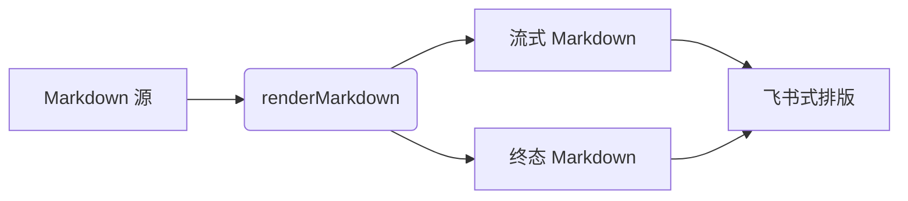

# Q4 产品周报 · 排版验收样张

这是一篇用来验收**飞书文档式排版**的完整样张：标题层级、正文节奏、列表、任务列表、引用、代码块、表格、图文混排、公式、图表与长内容都在这里。把它作为 AI 回复渲染出来，就能一次看全所有区块的间距与字号。

日常表达里有 **加粗结论**、*斜体强调*、~~已废弃的说明~~、`inlineCode()` 和 [一个外部链接](https://example.com/docs/markdown-typography)。中文标点后紧跟加粗也很常见：**结论：** 正文仍能正确加粗。价格写法如每月 $10、一年 $120，不应被误判成数学公式。

---

## 一、标题层级

### 1.1 三级标题：功能进展

#### 1.2 四级标题：细节拆分

##### 1.3 五级标题：补充说明

###### 1.4 六级标题：脚注级信息

飞书样式下每一级标题上方留白等于自身字号、h1 下方保留一条分隔线、字重 500；Notion 样式下标题更紧凑、字重 600、h1 没有分隔线，链接与列表标记也改用正文色。两套样式渲染的是同一份 HTML。

## 二、正文与行内元素

段落之间保持一个紧凑的块间距，行高跟随正文档位。中英文混排 Mixed CJK and Latin text 不应出现基线跳动，长链接 https://example.com/a/very/long/path/that/must/wrap/inside/the/message/column/without/creating/a/horizontal/scrollbar 应当自动折行而不是把时间线撑宽。

单换行在 `breaks: false` 下不会变成强制换行，
所以这一行和上一行会连成同一段——这是刻意与编辑器行为区分的地方。

## 三、列表

- 一级无序列表
  - 二级列表使用 `◦` 标记
    - 三级列表使用 `▪` 标记
- 列表项之间只留很小的间距
- 标记颜色使用主题强调色

1. 有序列表第一项
2. 有序列表第二项
3. 有序列表第三项

任务清单使用标准 GFM 语法，不需要任何自定义块标记：

- [x] 全局默认启用文档排版轴
- [x] 保持标准 Markdown 语法
- [ ] 冷启动视觉走查
- [ ] 25 个主题族回归

## 四、引用

> 引用的左边框是 2px 的主题色，文字降一级颜色，内部保持正常的段落与列表节奏。

> > 嵌套引用用于补充说明，缩进层级要能一眼分辨。

引用里也可以有 `代码` 和 **强调**，以及第二行文字。

## 五、代码块

带语言标注的代码块右上角是悬浮图标按钮（复制、软换行、可预览格式的 HTML/SVG 预览）：

```ts
interface DocumentScale {
  body: [number, number];
  heading: [number, number];
}

export const scale: DocumentScale = { body: [15, 25], heading: [24, 34] };
```

下面这一行故意很长，用来验证代码块自身横向滚动、而不是让整条消息出现横向滚动条：

```log
2026-11-12T07:55:26+08:00 INFO  markdown/render  source=assistant-answer blocks=42 cache=hit schema=2 elapsed_ms=13 viewport=1120 theme=feishu appearance=light locale=zh-CN
```

无语言标注的代码块：

```
plain text block
  keeps its indentation
```

HTML 代码块会额外出现一个「预览」图标按钮：

```html
<section class="card">
  <h1>Hello</h1>
</section>
```

## 六、表格

表头保持正常大小写、2px 下边框；宽表只在表格容器内横向滚动：

| 模块 | 状态 | 负责人 | 字号 | 备注 |
| :--- | :--: | ---: | :--: | :--- |
| 正文 | 已完成 | 设计系统 | 15 / 25 | 全局默认 |
| 标题 | 已完成 | 设计系统 | 24 / 34 ~ 15 / 22 | 六级阶梯 |
| 表格 | 已完成 | Web + Desktop | 14 / 22 | 局部滚动 |
| 热键走查 | 待开始 | QA | — | 需要人工确认 |

单元格里的价格 $10/月、年付 $100 也不应被解析成公式。

## 七、图文排版

单独成段的图片会渲染成 `figure`，标准 Markdown 的 title 变成可见图注：


同一段落里混排图片  和文字时，仍按普通段落处理，不会误判成图块。

带图注的第二张图，用于确认多图之间的垂直节奏：


## 八、公式

行内公式 $E = mc^2$ 与正文共处一行；块级公式单独成块：

$$
\hat{y} = \arg\max_{k} \frac{\exp(z_k)}{\sum_{j=1}^{K} \exp(z_j)}
$$

公式区域也只允许自身横向滚动，不影响外层消息列。

## 九、图表

图表代码块在支持图表的面板里会走 Mermaid 渲染，普通聊天里按代码块展示：



## 十、分隔线

---

以上。若所有区块的字号、行高、留白、边框与滚动行为都符合预期，说明文档排版轴已在全局默认生效。
